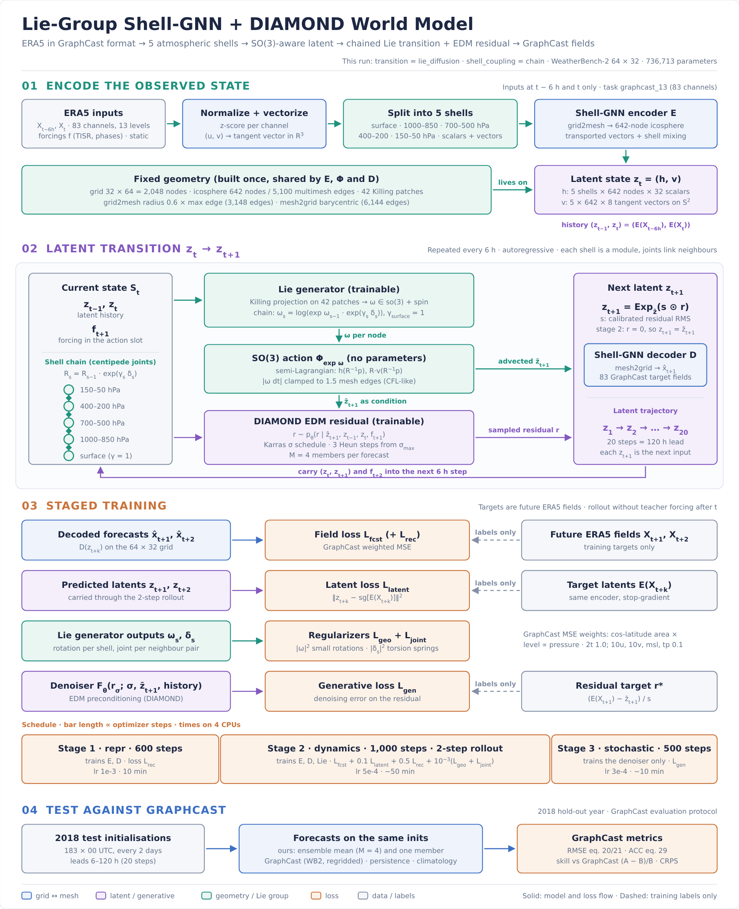

# world_for_climate

**Geometric stochastic climate world model.** ERA5 in GraphCast's task format is
split into shells (pressure-level groups plus a surface shell) on an icosahedral
mesh. A Shell-GNN encodes it into a latent made of scalars and tangent vectors on
S². The latent evolves `z_t -> z_{t+1}` through a Lie-structured SO(3) transition
plus a DIAMOND-style diffusion residual, and a Shell-GNN decoder maps it back to
the GraphCast target fields. Evaluation follows the GraphCast protocol:
latitude-weighted RMSE (eq. 20/21) and ACC (eq. 29).

설계 설명 (한국어): [docs/ARCHITECTURE_KO.md](docs/ARCHITECTURE_KO.md) ·
대용량 학습 (Lustre hourly 0.25°, GPU 96GB): [docs/LARGE_SCALE_KO.md](docs/LARGE_SCALE_KO.md)
실험 결과 (단계별: 1단계 세계 모델·절제, 2단계 RL 보강, 3단계 World Theory Model): [docs/results/README_KO.md](docs/results/README_KO.md)



## Layout

```
configs/                 smoke.yaml (P0), wb2_64x32.yaml (CPU, WeatherBench-2), p1_era5_graphcast13.yaml,
                         p2_1deg_96gb.yaml / p2_025deg_96gb.yaml + era5_lustre_hourly.yaml (one 96 GB GPU)
src/climate_wm/
  data/                  graphcast_mapping (TaskConfig, channel/shell layout), era5_lazy_loader,
                         sources (indexed hourly archive reader, conservative coarsening),
                         normalization, forcings (TISR, day/year progress), synthetic, inventory
  geometry/              spherical_mesh (icosphere, grid<->mesh), tangent_frames (wind vectors,
                         parallel transport), group_actions (so(3) exp/log, SO(3) action), shells
  models/                layers (PyG geometric message passing), graphs, latent,
                         shell_gnn_encoder/decoder, lie_generator, residual_dynamics,
                         stochastic_transition (DIAMOND EDM), world_model
  train/                 losses (GraphCast weighted MSE), trainer (3 stages)
  eval/                  graphcast_metrics, ensemble_metrics, climatology
  pipeline.py            config -> data / model / train / evaluate
scripts/                 smoke_test.py, train.py, evaluate.py, inventory.py, benchmark_step.py,
                         download_weatherbench2.py, compare_graphcast.py, report_comparison.py
tests/                   geometry, equivariance, data / task alignment, metrics, world model
```

## Quick start

```bash
pip install -e ".[dev,io]"
pytest                                   # unit tests (~10 s, CPU)
python scripts/smoke_test.py             # P0: synthetic data -> 3 stages -> GraphCast scorecard (~1.5 min, CPU)
python scripts/smoke_test.py --transition lie_residual --shell-coupling independent

# real ERA5 (fill in configs/era5_source.yaml first)
python scripts/inventory.py --era5 configs/era5_source.yaml --task graphcast_13
python scripts/train.py --config configs/p1_era5_graphcast13.yaml
python scripts/evaluate.py --checkpoint runs/p1/checkpoint.pt

# hourly 0.25 deg archive on one 96 GB GPU (docs/LARGE_SCALE_KO.md)
python scripts/inventory.py --archive configs/era5_lustre_hourly.yaml --task graphcast_13_no_w
python scripts/benchmark_step.py --config configs/p2_1deg_96gb.yaml --device cuda
python scripts/train.py --config configs/p2_1deg_96gb.yaml --device cuda --resume
python scripts/train.py --config configs/p2_025deg_96gb.yaml --device cuda \
    --init-from runs/p2_1deg/checkpoint.pt --resume
```

## Model options

| key | values |
|---|---|
| `model.transition` | `euclidean`, `lie`, `lie_residual`, `lie_diffusion`, `euclidean_diffusion` |
| `model.lie.shell_coupling` | `independent`, `chain` (articulated shells: the "liquid centipede" hypothesis) |
| `model.mesh.break_symmetry` | `true` (lat/lon features), `false` (exactly SO(3)-equivariant GNN) |
| `task.name` | `graphcast`, `graphcast_13`, `graphcast_operational`, `graphcast_13_no_w`, `graphcast_operational_no_w` |

## References in the project

- `weathernext` (GraphCast): task definition, loss weights, icosahedral mesh, TISR, evaluation definitions
- `diamond`: EDM denoiser, sigma distribution, sampler, autoregressive training with denoised frames
- `pytorch_geometric`: `MessagePassing` (edge_updater / propagate) for every GNN layer
- `dreamerv3`, `cosmos`: world-model framing (latent imagination rollouts)
